# トレーナー ― ピクトと一緒に、自宅トレーニング

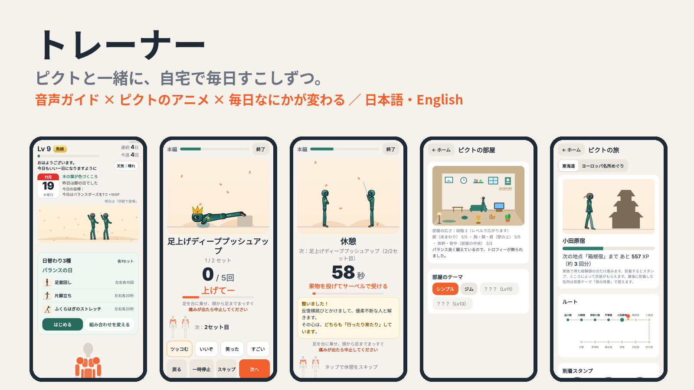

スマートフォンのブラウザで開く、自宅トレーニング用のWebアプリです。
トレーナーが隣で声をかけるように、**音声ガイド**と**棒人間（ピクト）のアニメーション**でメニューを案内します。
一人でも続けられるように、レベルや解放、旅、部屋づくり、図鑑やアルバムなどの「育てる楽しみ」を入れています。
いちばん大事にしているのは **「毎日なにかが変わる、開きたくなるアプリ」** であること。ピクトはいつも一所懸命で真剣です。真剣すぎて少しズレるところに、思わずツッコミたくなる余白を残しています。

**▶ アプリを開く：https://otomigus.github.io/trainer/**

- インストール不要。HTMLファイル1つで動きます
- 外部との通信はしません。記録はお使いの端末の中だけに保存されます
- 回数や負荷を競わせない設計です。続けることと、少しずつ解放されることを楽しむアプリです
- **日本語／English** を設定で切り替えられます（音声ガイドも英語になります。なぞかけは言葉遊びのため日本語のまま）

---

## はじめかた（iPhone の場合）

1. Safari で https://otomigus.github.io/trainer/ を開きます
2. 共有ボタンから「ホーム画面に追加」を選びます
3. 以降はホーム画面のアイコンから起動します

> 記録はURLと開き方（ホーム画面アプリ／Safariのタブ）ごとに別々に保存されます。どちらか一方で使い続けてください。

---

## 主な機能

### 声とアニメーションで案内
| 運動中 | 苦しい場面の応援 | 休憩中 |
|:--:|:--:|:--:|
| 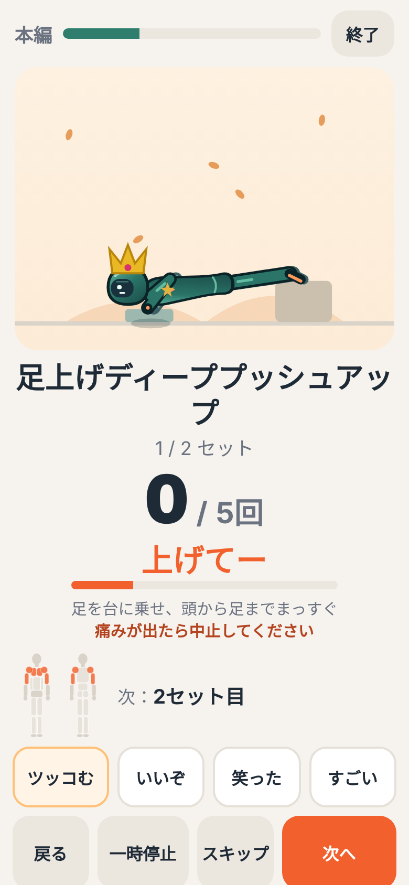 |  | 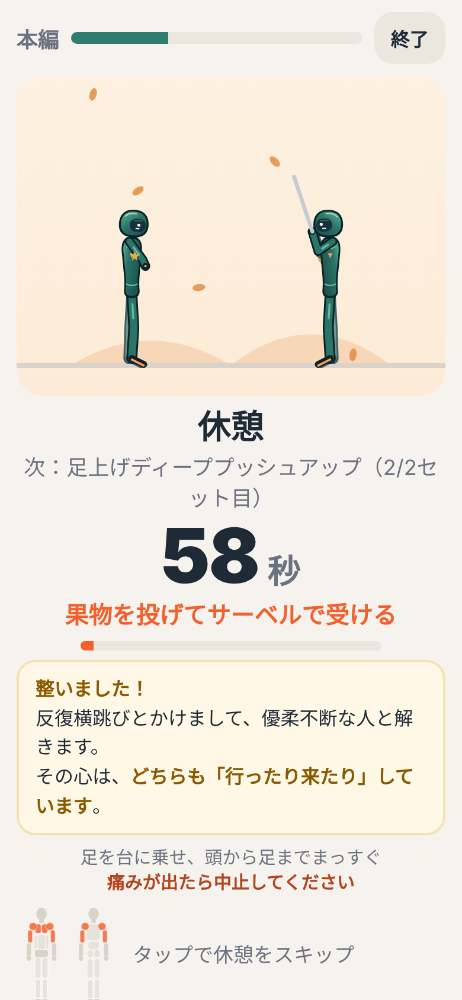 |

- 「下ろしてー（3秒）、上げてー（2秒）」のリズムを声と合図音で案内し、ピクトも同じテンポで動きます
- 秒数の種目は、10秒ごとに残り時間を読み上げます
- **画面のどこをタップしても次へ進みます**。運動中のチラ見と片手操作が前提です
- 終盤には、ピクトがアップで「あと少し！」と応援します。ラスト1回は決めポーズ
- 休憩中は、ねづっち風のなぞかけや、ピクトのコンビ芸が日替わりで見られます。休憩中に水を飲んだり汗をふいたりもします
- **なぞかけ**：いつもの32本に加えて、月ごとの期間限定（例：11月はボジョレー解禁・紅葉・3連休）と、あなたの記録が入る専用のなぞかけ（連続日数の節目、旅の到着、レベルアップの日など）

### ピクト
- 緑のスーツにバイザー顔、足もとには影。季節の背景の上でも輪郭と姿勢がはっきり見えるよう、濃い縁取りを付けています（夜の背景では水色のスーツ、金色ピクトは金のスーツ）
- 動きに合わせて首が傾き、視線が動き、まばたきします。運動中は真剣な目つき、ツッコまれると吹き出しのほうを見てから返します

### 毎日なにかが変わる
- **日めくり**：ホームに日付を日めくり風に表示。季節の一言、「昨日は脚の日でした」（休んだ日は「休養日でした」）のふり返り、その日だけの **小さな目標**（達成で +10XP）
- **明日の予告**：「明日はボジョレー解禁」「明日は〇〇で登場」など、翌日の変化を小さく予告
- **日替わり**：今日のピクト、登場の仕方、日常の動作、あいさつ、休憩の見せ方、エンディング。同じものが2日続かないように回しています
- **週・月・季節**：今週のミッション、月ごとの期間限定なぞかけ、月に1回の家族ミッション、季節のイベントと背景
- **ピクトの生活感**：まばたき、あくび、首をかしげる、足でリズム。朝は元気、夜は眠そう、深夜はときどき寝ています。しばらく放っておくと、水を飲んだり本を読んだりし始めます
- **環境音**（ホームだけ、小さく）：朝は鳥の声、昼はそよ風、夜は虫の声、お祭りの時期は遠くの太鼓

### ツッコミとリアクション
- ピクトはときどき **がんばりすぎます**（準備運動が本気すぎる、決めポーズが長い、力みすぎて震える、カウントを真剣に数えすぎる、大げさに感動する）
- ホームのピクトをタップすると、手を振る・驚く・笑う・照れるなど、そのときどきで違う反応をします。面白い動きのときにタップすると **ツッコミ** の吹き出しが出て、ピクトが「急に真面目になる」「さらに大げさにやる」「照れる」などで返します
- 運動中は、画面下の大きなボタンで **ツッコむ／いいぞ／笑った／すごい** が押せます。押しても運動は止まりません（片手で携帯を持ったままでも押せる位置と大きさです）

### ホーム：体のフィギュアと今日のおすすめ
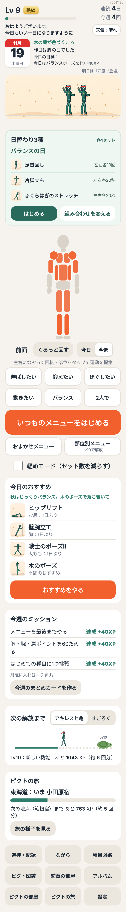

- 体のフィギュアを指でなぞると回転し、前と後ろが見られます。部位をタップすると、その部位の運動が出てきます
- 使った部位は色が濃くなるので、手薄なところがひと目で分かります
- 実施履歴から、しばらく空いている部位を優先した「今日のおすすめ」を出します。季節に合った種目や過ごし方（夏は水分補給、冬は準備運動を長めに など）もときどき混ざります
- 今週のミッション（週3つ）と、次の解放までの距離（アキレスと亀／すごろく）が見られます
- 朝・昼・夜であいさつと背景が変わります。天気はボタンで選べます（雨の日は傘をさしたピクト）

### 日替わり3種
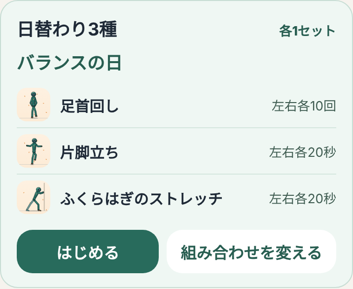

- 曜日ごとのテーマ（ゆるめる日、脚を鍛える日、肩・胸の日、足どりリズムの日、バランスの日、体幹の日、全身を動かす日）で、準備・メイン・締めの3種目を各1セット
- 週ごとに組み合わせが入れ替わり、「組み合わせを変える」でその日の組み合わせも選び直せます
- 3種目やり切ると「今日の3種目 実施済み」になります

### 2人で・ながら
| 2人で（家族と） | ながらメニュー |
|:--:|:--:|
|  | 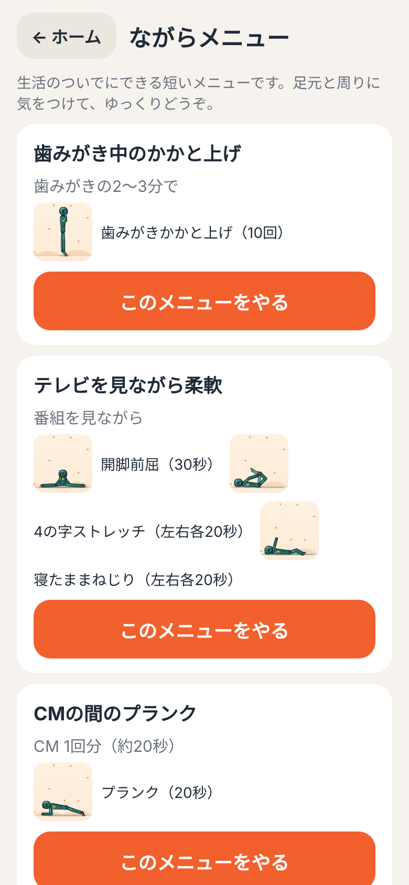 |

- **2人で**：向かい合って片脚バランス、背中合わせでゆっくりしゃがむ、手をつないで引き合いストレッチ、ハイタッチかかと上げ。2人のピクトが案内します
- **ながらメニュー**：歯みがき中のかかと上げ、テレビを見ながら柔軟、CMの間のプランクなど、生活のついでにできる短いメニュー集
- **家族ミッション**（Lv16〜）：月に1回、1週間だけ。「家族で合計5日参加」（家族の参加日はボタンで足します。回数や負荷は競いません）

### 育てる楽しみ
| ピクトの部屋 | ピクトの旅 | 勲章の部屋 |
|:--:|:--:|:--:|
| 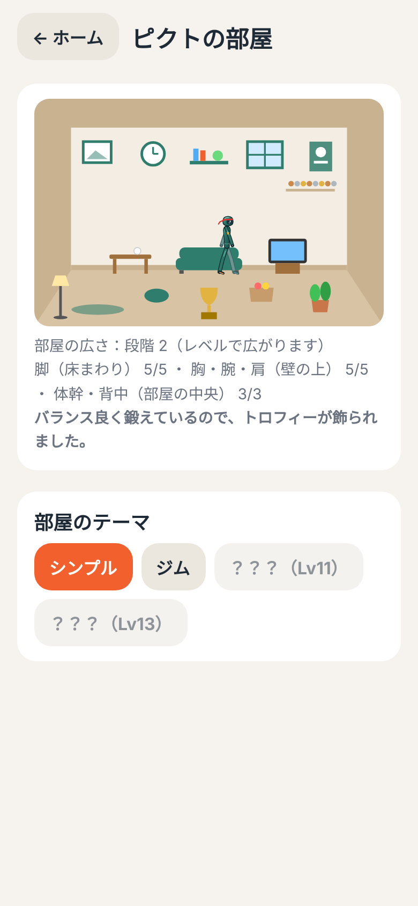 |  | 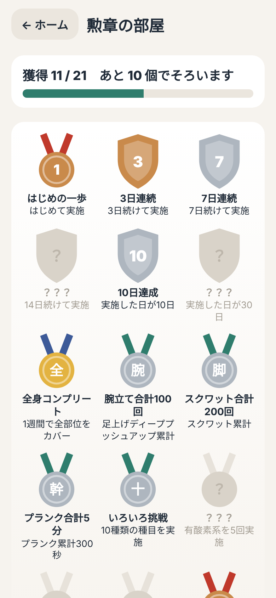 |

- **レベルと称号**：見習い → 駆け出し → 一人前 → 熟練 → 達人 …。レベルに上限はありません
- **ピクトの成長**：レベル5ごとに、胸のバッジ、やわらかなオーラ、きらめきと、少しずつ貫禄が増します
- **解放**：レベルが上がると、新しい種目・機能・衣装・部屋のテーマが開きます（まだのものは「Lv○で解放」と表示）
- **ピクトの部屋**：脚を鍛えると床まわり、胸・腕・肩は壁の上、体幹・背中は部屋の中央に、家具や飾りが増えます
- **ピクトの旅**：実施した分だけ、東海道（品川→京都）やヨーロッパ名所めぐり（パリ→アテネ）を進みます。到着するとスタンプやご当地衣装がもらえます
- **勲章の部屋**：連続日数や累計回数などで、勲章や盾が飾られていきます。休憩中に聞いたなぞかけは「なぞかけ帳」で読み返せます

### 図鑑とアルバム
| ピクト図鑑 | 成長アルバム | 種目図鑑 |
|:--:|:--:|:--:|
| 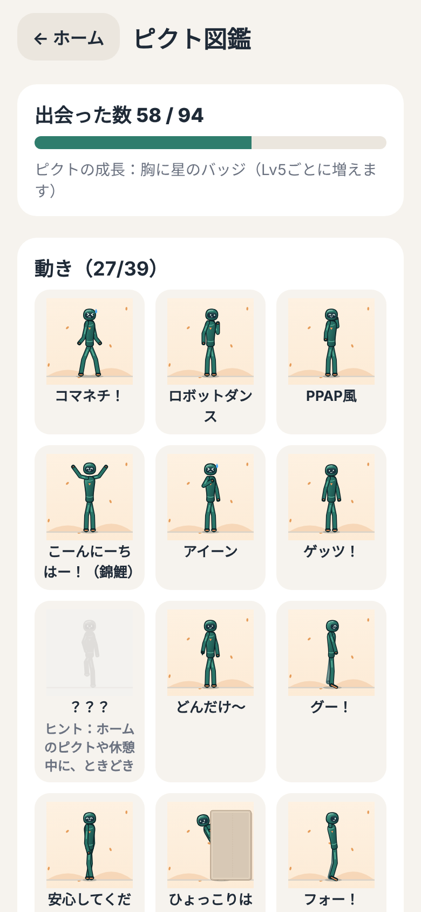 | 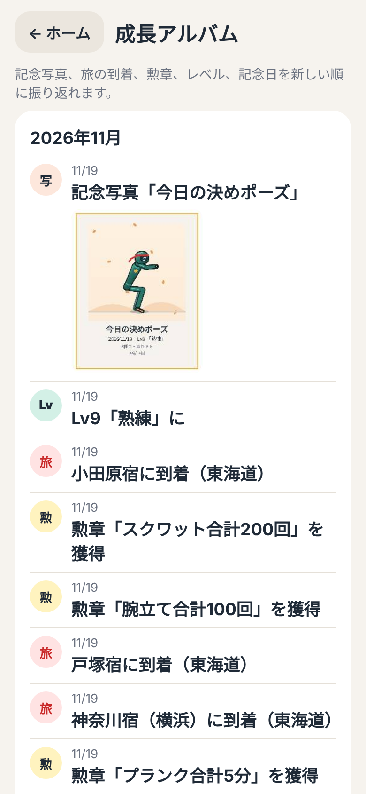 |  |

- **ピクト図鑑**：出会った動き・衣装・演出のコレクション。まだのものはシルエットとヒントで表示します
- **成長アルバム**：記念写真、旅の到着、勲章、レベル、記念日を時系列で振り返れます
- **種目図鑑**：すべての種目と、解放の予定（ロードマップ）

### 終わったあと
| 完了画面 | エンディング | 進捗・記録 |
|:--:|:--:|:--:|
| 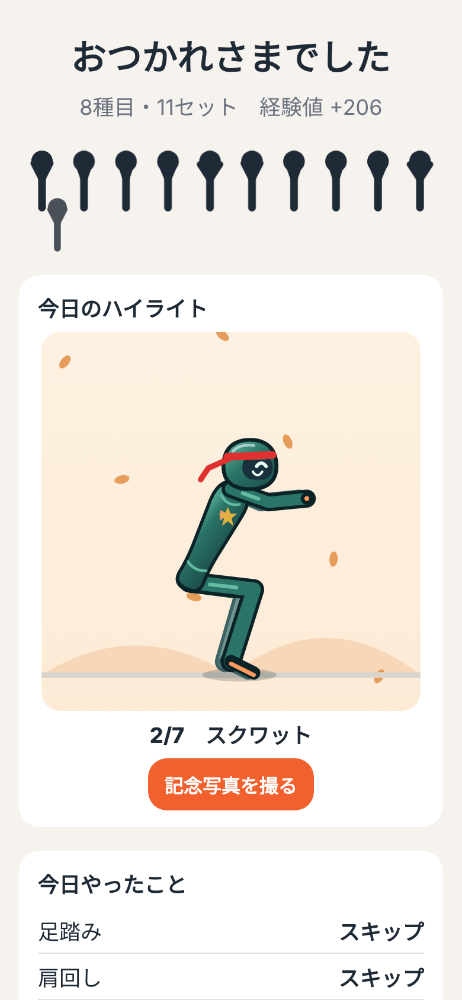 | 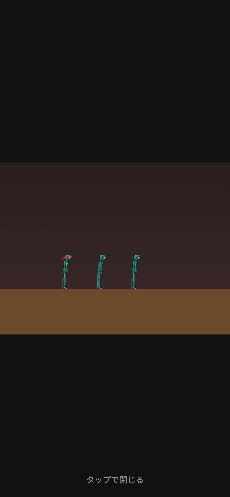 | 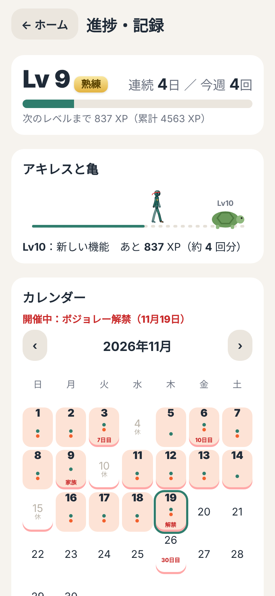 |

- 観客ピクトの拍手（連続日数が長いほど観客が増えます）、紙吹雪や花火、今日のハイライト
- 決めポーズを「記念写真」として画像で保存できます
- 最後まで終えた日は、ピクトたちが家に帰るエンディングが流れます（日替わり）
- カレンダーには種目の種類ごとに色のスタンプが付き、休んだ日は「休」と表示されます
- カレンダーには、これからの季節イベント・解禁日・記念日・家族ミッションの週も表示。タップで内容が見られ、2週間以内のものは「もうすぐ：〇〇」と告知します
- 12月になると「今年のまとめ」（一番やった種目、総経験値、聞いたなぞかけの数、旅の到達地点、記念写真）を画像で作れます。前の年の分もあとから見られます

### 今週のまとめカード

今週のレベル・連続日数・使った部位・よくやった種目・ミッションを1枚の画像にします。
保存して、LINEなどで家族に送れます（送信はご自身で行います。アプリから自動で送ることはありません）。

### ピクトのいろいろな動きと季節のイベント

- スポーツのピクトグラム風の動き、お笑いのギャグやダンスをイメージしたポーズ、日常の動作（歯みがき・読書・昼寝・料理・温泉）など
- 起動するたびに「今日のピクト」が1つ登場します。ごくまれに金色のピクトも現れます
- お正月・節分・ひな祭り・七夕・お盆・ハロウィン・クリスマスには、限定のあいさつ・登場・衣装があります

---

## 種目

| 分類 | 種目 |
|---|---|
| 準備運動・ほぐし | 足踏み、肩回し、肩甲骨寄せ、足首回し、エアゴルフスイング、ラジオ体操、餅つき（12月〜正月）、雪かき（冬） |
| 筋トレ | 足上げディーププッシュアップ、スクワット、かかと上げ、バードドッグ、プランク、壁腕立て、座ってひざ伸ばし ／ 解放：ヒップリフト、デッドバグ、サイドプランク、腰割り、パイクプッシュアップ、ウォールシット、片脚かかと上げ、リバースランジ、ワイドスクワット |
| ヨガ | 木、戦士Ⅱ、三角、踊り子、蝶（合せき）、鳩、コブラ、橋、屍、チャイルドポーズ |
| 柔軟 | 開脚前屈、前後開脚（上級）、ハムストリングス、腸腰筋、4の字、体側、猫の伸び、寝たままねじり、太もも前・ふくらはぎ・胸のストレッチ、アキレス腱伸ばし |
| 有酸素 | エア縄跳び、反復横跳び（ステップ）、サイドステップ＆タッチ、クロス足踏み、リズムかかと上げ・リズム足踏み（Lv14〜。合図音のテンポはBPM90／100／110から選択） |
| バランス | 片脚立ち、飛行機ポーズ、横つま先タッチ |
| 2人で | 向かい合って片脚バランス、背中合わせでゆっくりしゃがむ、手をつないで引き合いストレッチ、ハイタッチかかと上げ |
| ながら | 歯みがき中のかかと上げ ほか7メニュー |

英語表示のときは、種目名も英語（Squat、Plank、Push-up など）になります。

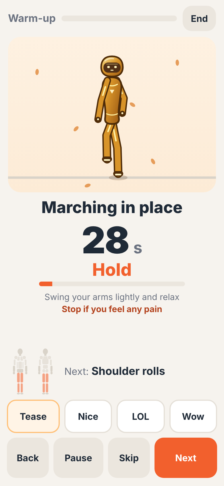

---

## 安全への配慮

- すべての種目に「**痛みが出たら中止してください**」を表示しています
- 脚の種目は、ゆっくりしたテンポを前提にしています
- 跳ぶ・ステップする種目は **1セット30秒まで、必ず休憩をはさむ** 設定にしています（メニューを編集しても30秒を超えません）
- 叱ったり煽ったりする言葉は使いません
- 「軽めモード」で、きつい日はセット数を減らせます

> このアプリは運動の習慣づくりを手伝うためのものです。医療上の助言ではありません。体に不安がある場合は、医師や専門家に相談してください。

---

## 設定でできること

- 音声ガイドのON/OFF、話す速さ
- 合図音・効果音（拍手・ファンファーレ・太鼓）、環境音、合いの手、なぞかけ、遊び演出のON/OFF
- リズム種目のテンポ（BPM90／100／110）
- 背景テーマ（季節・金色・夜空・旅の背景）
- 誕生日（お祝いの演出用。端末の中だけに保存）
- メニューの編集（JSON）

---

## データについて

- 記録はブラウザの localStorage（キー：`trainerApp.v1`）に保存します。サーバーには送りません
- バージョンアップしても、保存形式は引き継がれます
- 端末を替えるときやバックアップには、「進捗・記録」画面の書き出し（JSONをコピー）を使ってください

---

## 更新のしかた（管理者向け）

1. 新しい `index.html` を用意します
2. このリポジトリで「Add file」→「Upload files」を選び、`index.html` を上書きアップロードします
3. 1〜2分で公開ページに反映されます。URLが変わらないので、利用者の記録はそのまま残ります

ホーム画面の右上の隅に、バージョン（YYMMDD形式。同じ日の2回目以降は末尾に b, c…）が小さく表示されます。

---

## 技術メモ

- 単一HTML（HTML／CSS／JavaScript）。外部ライブラリなし
- 音声：Web Speech API（SpeechSynthesis, ja-JP）
- 効果音：Web Audio API で合成
- 画面スリープ防止：Screen Wake Lock API（対応ブラウザのみ）
- アニメーション：SVG と JavaScript。画像の書き出しは Canvas

## 更新履歴

| バージョン | 内容 |
|---|---|
| 261119c | 261118g（新種目6種・日替わり3種）を土台に、261119b の変更（ピクトの濃さ調整とツッコミ時の視線、英語表示と英語の音声ガイド、帯の上端の修正、折り返し調整）を取り込み。新種目と日替わり3種も英語に対応 |
| 261119b | 261118f のピクト（スーツ＋バイザー顔＋影、首の傾き・視線・まばたき・目の表情）を正式に取り込み、縁取りを濃くして季節背景の上での見やすさを調整。261119 の英語表示・帯の切れ表示の修正・折り返し調整を引き継ぎ、言語を切り替えたときに画面の一部が切り替わらない不具合と、「今日の目標」が単語の途中で折り返す点を修正 |
| 261119 | ピクトの新しい描画（スーツ＋バイザー顔＋影、色4種）と演技（首の傾き・視線・まばたき・真剣な目・にやり）、季節背景の上での見やすさ調整、英語表示と英語の音声ガイド、ホーム上部の帯の切れ表示の修正、ホームの文章の折り返し調整、アキレスと亀のピクトが表示されない不具合の修正 |
| 261118g | 新種目6種（肩甲骨寄せ、壁腕立て、座ってひざ伸ばし、サイドステップ＆タッチ、クロス足踏み、横つま先タッチ）と日替わり3種メニュー |
| 261118e・f | ピクトの新しい描画（スーツ＋バイザー顔＋影、色4種）と演技（首の傾き・視線・まばたき、目の表情） |
| 261118d | 毎日の変化（日めくり、小さな目標、昨日のひとこと、明日の予告、日替わりのローテーション）、ピクトの生活感とタップの反応、がんばりすぎの動きとツッコミ、運動中のリアクションボタン、なぞかけ32本＋期間限定＋あなた専用、ラジオ体操・餅つき・雪かき、リズム種目、家族ミッション、年間まとめ、環境音、カレンダーのイベント告知 |
| 261118c | ピクトの成長、ピクト図鑑、なぞかけ帳（26本に）、季節イベント、季節のおすすめ、2人で、ながらメニュー、今週のまとめカード、成長アルバム。「戦士のポーズⅡ」に表記修正。部屋の小物がピクトと一緒に動くよう修正 |
| 261118b | 飽きさせない統合版：ヨガ・柔軟、スポーツや面白い動き、部屋、旅、ミッション、エンディング、効果音など |
| 261118 | レベル解放と称号、おすすめ、有酸素・バランス系、勲章の部屋、なぞかけ |
| 初版 | 音声ガイドとアニメーション、記録、部位ヒートマップ、セットごとの保存 |
